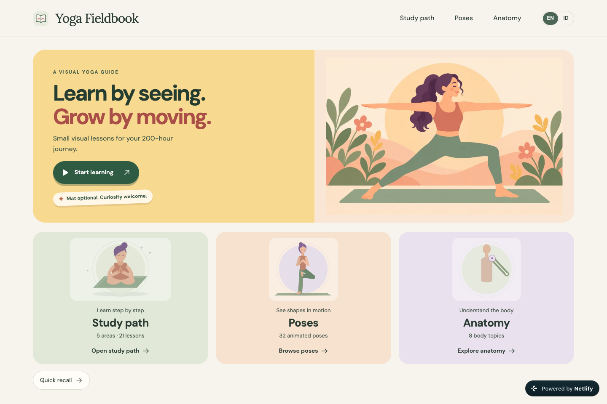

# Yoga Fieldbook

Yoga Fieldbook is a visual study companion for introductory yoga teacher training.

[Open Yoga Fieldbook](https://yoga-fieldbook.netlify.app)



The material supports independent study alongside teacher-led instruction. See the [asset register](content-review/asset-register.json) for artwork sources and attribution.

## Features

- **[Study path](https://yoga-fieldbook.netlify.app/study)** groups 21 introductory lessons into five areas, with a route from visual lessons to recall and teaching rehearsal.
- **[Pose library](https://yoga-fieldbook.netlify.app/poses)** offers 32 animated poses. Search by English or Sanskrit name, filter by pose family, or explore Warrior II in an interactive 3D view.
- **[Anatomy explorer](https://yoga-fieldbook.netlify.app/anatomy)** covers eight topics with interactive illustrations, including joints, breathing, and the skeleton.
- **[Quick recall](https://yoga-fieldbook.netlify.app/review)** gives you short quizzes and reflection prompts. Review answer explanations and return to related lessons.
- **[Teaching rehearsal](https://yoga-fieldbook.netlify.app/teaching)** lets you build a pose sequence, write teaching cues, time a practice run, and save feedback.
- **Progress backup** keeps your activity in your browser and lets you export or restore it as a JSON file.
- **[English and Bahasa Indonesia](https://yoga-fieldbook.netlify.app/id/)** are available through the language switch. Some lessons and quizzes are still in English.

## Run locally

Use Node.js 24 and npm.

```sh
npm ci
npm run dev
```

## Verify the build

```sh
npm run check:content
npm run test:domain
npm run build
npm run test:sites
```

The static site is built into `dist/client`. When deploying it to a static host, configure navigation routes to fall back to `index.html`.
